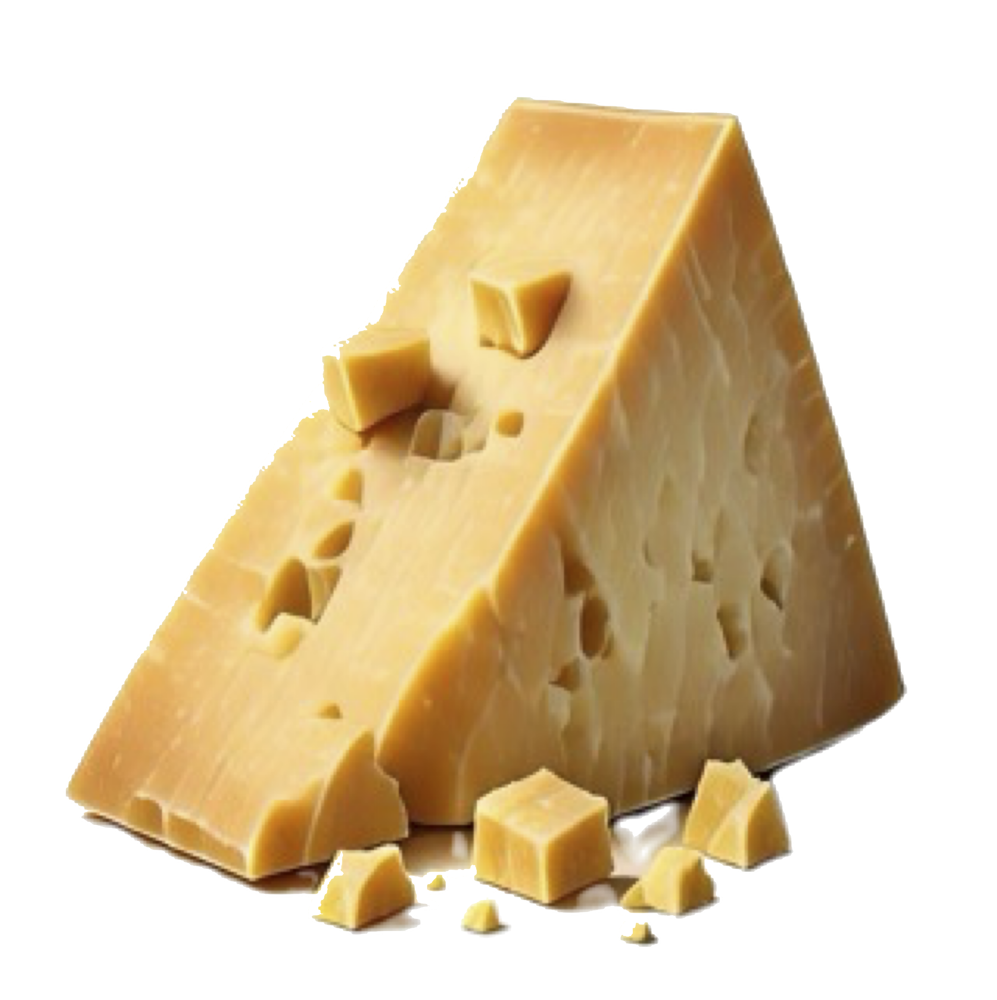
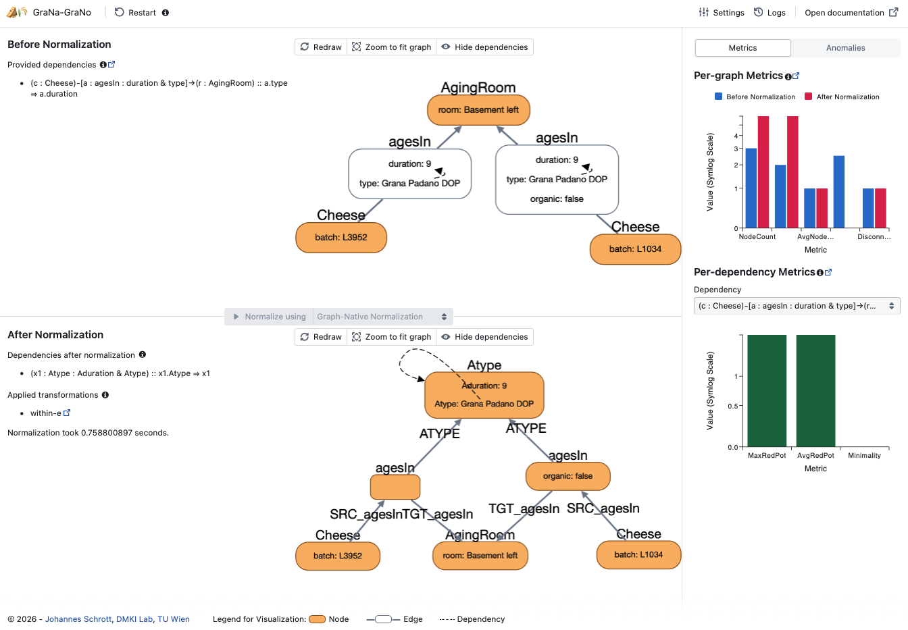

# Welcome to GraNa-GraNo 

GraNa-GraNo is a web-based application that allows to learn about the effects redundancies have on LPGs and how to resolve them
using normalization.

## Getting Started

1. Install [Docker](https://www.docker.com) including Docker Compose
2. Clone GraNa-GraNo from [GitHub](https://github.com/dmki-tuwien/grana-grano) to your host 
`bash
git clone https://github.com/dmki-tuwien/grana-grano --recurse-submodules
`
3. Start the Docker containers using 
`
docker compose --profile grana-grano up --build
`
4. GraNa-GraNo is available on <http://localhost/>! 🎉

## User Guide
GraNa-GraNo's GUI is divided into a menu bar, that allows to reset the application, and 3 main parts:
the graph and dependencies before normalization on the top, the graph and dependencies after normalization in the bottom, and the metrics and dependencies leading to anomalies in the sidebar.

<figure markdown="span">
  
  <figcaption>The GraNa-GraNo application (click on image to enlarge)</figcaption>
</figure>

The following steps need to be taken when using GraNa-GraNo:

* A graph store must be selected. Currently [Neo4j](https://neo4j.com) and [Memgraph](https://memgraph.com) are supported.
* A [normalization scenario](scenarios.md) needs to be chosen and loaded.
* After loading [metrics](metrics.md) are computed before normalization and the provided [dependencies](dependencies.md) are listed and can be edited. A visualization of the provided graph incl. the dependencies is shown.
* Clicking on "Normalize" normalizes the graph according to the provided dependencies.
* After normalization, again the [metrics](metrics.md) are computed, the dependencies after normalization are shown, and the normalized graph is visualized.

Optionally, users can enable GraNa-GraNo's LLM functionality. 
When enabled, fresh labels for nodes and edges created during the normalization process are no longer constructed based on properties, but are generated using an LLM.
